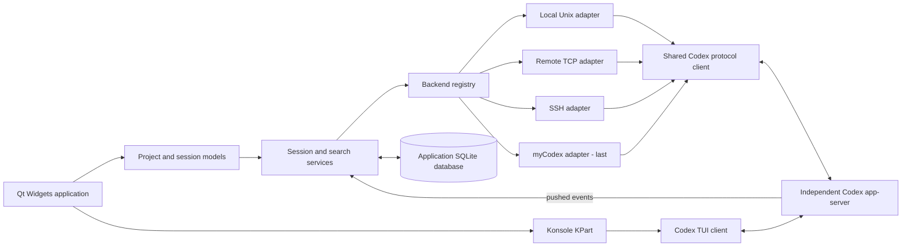

# Project design

Status: adopted architectural direction; detailed contracts below are design
proposals, not implemented or runtime-tested behavior. Last updated: 2026-11-08.

## 1. Product and agreed constraints

Build a native Linux application that makes dozens of Codex conversations across
several execution environments easy to find, open and return to.

| Area | Requirement |
| --- | --- |
| Platform | Linux only, with tight KDE integration. No portability work for other operating systems. |
| Desktop baseline | Debian 13 / Ubuntu 26.04 or newer; X11 required, Wayland optional. |
| UI technology | No JavaScript or TypeScript UI. Use native Qt Widgets in C++. |
| Session interaction | Embed the existing Codex TUI first. A native conversation view can come later. |
| Navigation | Recently used projects, directories and worktrees, with recently used conversations beneath them. |
| Search | Titles and full user/assistant conversation text, within a project or across configured backends. |
| Status | Pushed events for running, idle and waiting states; graphical indicators on sessions and projects. |
| Polling | No periodic status queries, process inspection, output-silence detection or timer-based refresh. Initial connection and reconnection may query state. |
| Persistence | Active work survives closing the GUI or losing SSH. Resuming the same conversation is sufficient; preserving the exact terminal screen is unnecessary. |
| Scale | Design for 40–80 active sessions across hosts, with room to grow. Saved-history volume remains to be measured. |
| Terminal | Prefer a mature embeddable terminal; optimize only when realistic measurements justify it. |
| Distribution | Flatpak is the primary delivery format. |
| Licensing | Open source; choose an exact license compatible with the dependencies before distributing code. |

Backend delivery order is fixed: **existing local Unix app-server sockets →
remote TCP app-server endpoints → SSH-forwarded sockets → myCodex**.

This document defines behavior and architecture. The
[initial UI design](ui.md) starts with a simple IDE layout: expandable projects
and sessions on the left, All/Active navigation tabs, and the terminal workspace
on the right. Interaction refinements, colors and notification preferences remain
part of the ongoing UI design stage.

## 2. Technology decisions

| Component | Choice | Reason and boundary |
| --- | --- | --- |
| Language | C++20 | Direct access to Qt, KDE and Konsole without a second language or binding layer. |
| GUI | Qt 6 Widgets | Mature native widgets and model/view support for large project/session lists. No QML, WebEngine or web UI. |
| Desktop integration | Selected KDE Frameworks 6 | KParts, configuration and notifications as needed; avoid pulling in frameworks without a concrete use. |
| Terminal | Konsole KPart | Reuse KDE's terminal emulator, fonts, selection, scrollback and PTY handling. |
| Protocol transport | Boost.Asio / Beast | One asynchronous WebSocket implementation over Unix sockets, TCP and TLS; a stream adapter also supports a host relay. |
| JSON and GUI dispatch | Qt JSON and queued signals | Explicit protocol types at the boundary; update Qt models on the GUI thread. |
| SSH | Host OpenSSH | Respect existing SSH aliases, agent, host keys, jump hosts and native socket forwarding. |
| Local storage | SQLite | Store application-owned metadata. FTS5 is available for a conversation index if required. |
| Build | CMake and Ninja | Fits the Qt/KDE ecosystem and Flatpak builds. |
| Validation | QtTest / CTest, sanitizers, perf and heaptrack | Test protocol behavior and measure the real packaged application. |

[Qt Widgets](https://doc.qt.io/qt-6/qtwidgets-index.html) and
[Qt model/view](https://doc.qt.io/qt-6/model-view-programming.html) provide the
native application foundation. Konsole exposes an embedding interface in
[Part.h](https://github.com/KDE/konsole/blob/master/src/Part.h); KDE's
[Dolphin terminal panel](https://github.com/KDE/dolphin/blob/master/src/panels/terminal/terminalpanel.cpp)
is an existing integration reference. Beast documents its
[WebSocket streams](https://www.boost.org/doc/libs/latest/libs/beast/doc/html/beast/using_websocket.html),
and Asio supports [Unix-domain sockets](https://www.boost.org/doc/libs/latest/doc/html/boost_asio/overview/posix/local.html).

Konsole is the first choice. QTermWidget remains a contingency if measured
embedding or packaging problems cannot be resolved reasonably. A custom terminal
renderer, a Rust/C++ split, and GTK/VTE would add work without improving the
agreed KDE-first direction enough to justify them now.

Flatpak supplies the Qt/KDE runtime; host distributions do not need matching
development packages or a separately installed Konsole. See the
[Flatpak design](flatpak.md) for the host boundary and permission rationale.

## 3. Architecture and ownership

The diagram shows logical responsibilities, not one process for each box. The
initial implementation is one GUI process with internal modules and worker
execution contexts. Backend adapters are separate C++ modules behind one
interface, not a public binary plugin system in the first version.

The GUI owns presentation, connection profiles, metadata and search aggregation.
Each app-server owns its conversations and running work. The terminal contains a
TUI client connected to that same server; it must not accidentally start another
engine against shared conversation files.

Maintain one long-lived protocol connection per connected backend for inventory
and pushed status. Opening a terminal creates an additional TUI connection for
that conversation. Do not create a TUI or resume every saved conversation merely
to populate the list.

Use asynchronous I/O with bounded queues. Keep network parsing and bulk search
or database work off the GUI thread. Deliver model changes through queued Qt
signals. Coalesce repaint work during bursts without discarding meaningful
state transitions. No worker thread per conversation is required.

The GUI does not need an always-running companion daemon. Closing it ends its
notification reception. Backend work continues because the app-server has an
independent lifetime. Background desktop notifications after the GUI exits are
outside the initial requirements.

## 4. Protocol boundary and compatibility

Use the documented app-server protocol and validate it against the exact Codex
versions selected for support. Generate JSON schemas from those versions for
contract fixtures; generated TypeScript is not needed in this application.
Initialize each client correctly and opt into experimental capabilities only
when a feature needs them.

Keep protocol details in one shared client, not in each transport adapter. It
handles request IDs, responses, notifications, server-initiated requests,
initialization, cancellation where supported, and version-specific decoding.
Unknown optional fields should not break otherwise compatible messages.

The initial connection builds a capability record from initialization data,
the tested version matrix and bounded feature checks. Do not assume a universal
capability-negotiation method exists. Unsupported methods disable the affected
feature with a clear reason. Missing event support must never activate a polling
fallback.

Current source supports WebSocket transport over Unix sockets and TCP. The
`codex app-server proxy --sock PATH` command relays bytes to an existing Unix
socket: the client still performs the WebSocket handshake and framing. It is
not a newline-JSON conversion service and does not start a server. Direct
app-server stdio transport is a different mode. References:
[app-server documentation](https://learn.chatgpt.com/docs/app-server),
[transport source](https://github.com/openai/codex/blob/main/codex-rs/app-server-transport/src/transport/mod.rs),
[proxy source](https://github.com/openai/codex/blob/main/codex-rs/stdio-to-uds/src/lib.rs).

The research baseline included Codex CLI 0.166.0 and upstream source inspected
on 2026-11-08. That is evidence for the design, not yet a supported minimum
version. Experimental search and project APIs especially need pinned contract
tests before release.

## 5. Events and connection recovery

### Normal operation

Session state comes from protocol notifications, including
`thread/status/changed`, turn lifecycle events and structured input/approval
requests where available. The current server broadcasts thread status changes;
listing sessions must not require resuming every thread. See the server's
[thread status implementation](https://github.com/openai/codex/blob/main/codex-rs/app-server/src/thread_status.rs).

There is no interval that asks whether a session has become idle. Do not scrape
terminal output, inspect process CPU use, watch for terminal silence, or use
Konsole's activity/silence notifications as Codex state. Disable those optional
terminal notifications for this integration. Normal terminal rendering is
independent of backend status.

User-requested search and history reads are allowed. A metadata notification may
trigger a bounded read of missing metadata or conversation text. These operations
must not become repeated status checks. Repaint scheduling, search debounce and
disconnected-transport retry delays are not sources of session state.

### Connection and reconnection

1. Establish the transport and initialize the protocol client.
2. Begin receiving events and assign a new connection generation.
3. Read initial inventory, loaded-thread information and status as supported.
   Paginate the inventory; do not load every conversation body.
4. Reconcile the snapshot with events received while it was being assembled.
   Discard responses from an older connection generation. Resolve affected
   threads within this initialization phase before claiming their state is known.
5. Once ready, use pushed events for state changes.
6. On transport failure, mark live state unknown/disconnected. Preserve cached
   titles and history as stale data, not as current execution state.
7. Reconnect with bounded backoff and cancellation, then repeat initialization.

Do not assume the server offers a durable replay cursor or an atomic snapshot
across all requests. Snapshot/event ordering is a correctness test, including
turns that begin or complete during initialization. If the available protocol
cannot resolve a race reliably, report unknown state rather than inventing it.

Connection health follows transport errors, closure and connection attempts.
There is no additional application heartbeat that polls session status. A silent
network partition may only become known when the transport detects it.

### State model

Store connection state separately from execution and attention state.

| Protocol observation | Application meaning |
| --- | --- |
| `notLoaded` | Saved conversation is not loaded in this server. |
| `idle` | Loaded conversation has no active turn. |
| `active` | A turn is running. |
| `active` with `waitingOnApproval` | The turn needs an approval response. |
| `active` with `waitingOnUserInput` | The turn needs structured user input. |
| `systemError` | Server-reported error state. |
| Disconnected or insufficient information | Current execution state is unknown. |

These values are defined in the current
[thread protocol types](https://github.com/openai/codex/blob/main/codex-rs/app-server-protocol/src/protocol/v2/thread.rs).
Keep multiple active flags if the server supplies them. A question written in an
ordinary assistant message does not automatically constitute structured waiting
for input.

Completion/unread attention is separate from idle state. Use turn outcome events
to distinguish success, failure and interruption; an active-to-idle transition
alone is insufficient. Project indicators aggregate their child sessions and
retain counts for waiting, active, failed and disconnected states. The visual
priority, colors and accessibility treatment will be decided in UI design.

The TUI is initially the approval and input surface. The GUI observes and brings
the relevant session to the user's attention. It must not race the TUI to answer
server requests. Reconnection and pending-request replay need explicit tests.

## 6. Session lifetime and terminal behavior

An app-server must already have a lifetime independent of the GUI and its SSH
transport. Attaching to a foreground server tied to a dying login shell cannot
provide the persistence guarantee; the backend must disclose that limitation.

Existing daemon facilities or an explicitly configured Linux service can own a
server. The first adapters attach to existing servers and do not install services,
upgrade Codex, restart servers or launch daemons as a side effect of connecting.
Future lifecycle operations must be explicit capabilities and user actions.

Current server lifecycle code retains active turns when clients disconnect and
can unload inactive, unsubscribed threads later. Unloaded history remains
resumable. Verify this for supported versions, including pending approvals and
tool execution: [thread lifecycle source](https://github.com/openai/codex/blob/main/codex-rs/app-server/src/request_processors/thread_lifecycle.rs).

When opening a conversation, obtain a terminal launch plan from its backend and
start the Codex TUI with an explicit endpoint and thread ID. Closing the terminal
detaches that client; it does not mean cancel the turn or stop the server. A
separate explicit cancel action would have different semantics.

Create terminal widgets lazily. Session counts of 40–80 do not imply 40–80 live
terminal renderers. Keep only user-opened terminals, with bounded scrollback and
no off-screen animation work that can reasonably be avoided. Exact tab retention
and split behavior belong to UI design.

No tmux layer is required merely to preserve a conversation. Existing myCodex
tmux/byobu workflows remain a separate integration concern; see
[backend design](backends.md).

## 7. Projects, identity and recent use

Use application-assigned persistent backend IDs. A conversation key contains its
backend ID and Codex thread ID. A filesystem path or a thread ID on its own is not
a globally unique execution identity.

Projects contain one or more locations: a backend, an environment-relative path,
and optional repository/worktree metadata. The same absolute path on two hosts
does not identify the same location. A remote path must not be resolved with the
GUI host's filesystem APIs. A non-Git directory is a valid project.

Use server-provided project metadata where supported. Maintain an application
mapping for backends without that API and for grouping locations across hosts.
Do not automatically merge projects because their names or repository URLs
match. Explicit grouping can be designed later. Current upstream
[project types](https://github.com/openai/codex/blob/main/codex-rs/app-server-protocol/src/protocol/v2/project.rs)
provide useful optional metadata but are not the only source of project identity.

Git worktree discovery, when requested, runs in the relevant backend environment
using machine-readable Git output. It is not a recurring repository scan.

Persist local last-opened/last-interacted timestamps separately from server
activity timestamps. Proposed MRU behavior is to use explicit user interaction
and server conversation recency, with stable tie-breaking; background status
updates and output chunks must not continuously reshuffle the navigation tree.
The exact MRU interaction policy will be settled during UI design.

Explicitly request the intended server sorting and filters. The current
`thread/list` defaults are not a universal MRU/all-sources listing: creation-time
ordering and source/provider filters can hide or misorder sessions. Support
pagination and deliberate archived-session handling. See
[thread request definitions](https://github.com/openai/codex/blob/main/codex-rs/app-server-protocol/src/protocol/v2/thread.rs).

## 8. Search and storage

Global search fans out to connected backends and merges results with backend,
project and conversation provenance. Project search restricts results to that
project's locations. Slow or disconnected backends must not block completed
results from other backends. Cancellation and pagination are required.

Search titles and user/assistant conversation text. Tool logs, files in the
working directory, attachments and terminal scrollback are not implicitly part
of this requirement.

Prefer server-side full-text search when the deployed protocol supports it. In
the inspected source, `thread/list.searchTerm` searches titles, while experimental
`thread/search` and `thread/searchOccurrences` provide conversation search.
`thread/search` does not have a working-directory filter, so project search must
filter across the necessary result pages or use a project-aware local index;
filtering only the first page is incorrect. References:
[thread request definitions](https://github.com/openai/codex/blob/main/codex-rs/app-server-protocol/src/protocol/v2/thread.rs),
[method declarations](https://github.com/openai/codex/blob/main/codex-rs/app-server-protocol/src/protocol/common.rs),
[request processor](https://github.com/openai/codex/blob/main/codex-rs/app-server/src/request_processors/thread_processor.rs).

If server search is unavailable or insufficient, use an application-owned
[SQLite FTS5](https://www.sqlite.org/fts5.html) index populated through supported
history APIs. Initial import, reconnection reconciliation and conversation events
drive indexing. Do not poll rollout files or depend on Codex's private SQLite
schema. Expose index coverage: partial, current for the connected generation, or
stale/offline. Never present a partial index as a complete search of a backend.

Keep SQLite metadata tables for backend profiles, project/location mappings,
thread summaries, recent-use history, attention acknowledgments and optional
index progress. Cached data is derivative; the server owns conversation history.
Database migrations must be transactional and preserve user configuration.

Do not store authentication tokens in ordinary profile rows or logs. Offline
conversation caching, retention and clearing controls need a separate product
decision before full-text indexing becomes a default. A remote-only search mode
can avoid retaining full conversation bodies locally.

## 9. Linux integration and diagnostics

Use native PTYs, Unix sockets, file-descriptor readiness and D-Bus integration
where appropriate. Keep process execution arguments structured. Avoid shell
string construction for project names, paths or thread IDs.

Use KDE/portal facilities for desktop notifications and file selection. Tray
behavior is not yet decided. OpenSSH manages SSH credentials. Codex credentials
remain in their execution environment; Archcodex does not copy, inspect or expose
the host's `~/.codex/auth.json` as an integration mechanism.

Structured diagnostics should include backend ID, connection generation,
operation and protocol error category, with credentials and conversation text
redacted by default. A failed backend should not freeze the GUI or erase its
saved history. Logging is for diagnosis, not a status-inference mechanism.

## 10. Validation and delivery sequence

UI design is in progress in the [initial UI design](ui.md). Implementation follows
only after that design work is agreed. Backend milestones remain in this order:

1. Local Unix: prove packaged Konsole embedding, explicit attachment, initial
   inventory, pushed state, search and conversation continuity.
2. Remote TCP: add WebSocket/TLS endpoints, authentication and failure isolation.
3. SSH: add native socket forwarding, host configuration and reconnect behavior.
4. myCodex: add machine-readable integration with any small upstream changes
   agreed separately.

All milestones use the same session/event model. Each new adapter must pass the
same contract tests rather than inventing its own session behavior.

| Validation area | Required evidence before claiming support |
| --- | --- |
| Events | Correct state changes with no periodic state queries during steady operation. |
| Recovery | No stale snapshot overwrites; disconnected state is honest; pending input survives/reappears correctly. |
| Persistence | Active turns continue after GUI exit, terminal close and SSH loss when the server has independent lifetime. |
| Multi-client | GUI and TUI attach to the same execution server without duplicate turns or competing approval replies. |
| Terminal | Unicode, input methods, selection, clipboard, resize, signals, scrollback and sustained output work in the Flatpak. |
| Scale | Realistic 40- and 80-session workloads, several hosts, bursts and slow backends; measure latency, memory, CPU and idle wakeups. |
| Search | Multi-page results, project filtering, full conversation coverage, cancellation and explicit partial/offline results. |
| Packaging | Required X11 desktop matrix, runtime/plugin compatibility and the permission checks in the Flatpak design. |

Set numerical performance budgets after a representative baseline is measured.
Do not claim throughput or memory targets from widget choice alone. Trace-driven
tests should verify that an idle connected GUI sends no periodic status RPCs.

## 11. Decisions still open

- Final UI design, MRU interaction details, notification preferences and terminal
  retention policy.
- Exact supported Codex versions and optional protocol capabilities.
- Final Flatpak application ID, runtime branch, publication channel and license.
- Credential delivery into the embedded TUI without putting secrets in command
  arguments; this is a release gate, not permission to use insecure placeholders.
- Default offline search caching and realistic saved-history dataset size.
- Whether future releases need explicit server lifecycle controls or a native
  conversation view.

No application code, packaging configuration or myCodex changes are part of this
documentation milestone.
